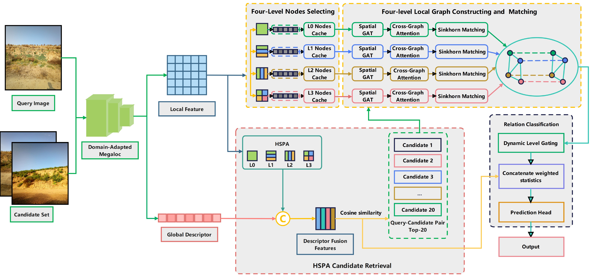

# HeriMatch

**Cross-batch viewpoint association in heritage patrol images**  
**面向遗产巡护图像的跨批次视点关联**

HeriMatch combines domain-adapted MegaLoc features, Heritage Spatial Pyramid Aggregation (HSPA), and multilevel graph matching to retrieve and verify images of the same heritage viewpoint across patrol batches.

HeriMatch 结合领域适配的 MegaLoc 特征、遗产空间金字塔聚合（HSPA）和多层图匹配，实现不同巡护批次间同一遗产视点图像的检索与核验。

**Related manuscript / 相关论文：** *HeriMatch for cross batch viewpoint association in heritage patrol images*

This package provides the core algorithm implementation. Dataset preparation, experimental protocols, benchmark comparisons, and visualization scripts are maintained separately.

本目录提供算法核心实现。数据准备、实验协议、基线比较及可视化脚本独立维护。

## Contents / 目录

- [Overview / 方法概览](#overview)
- [Repository structure / 项目结构](#structure)
- [Installation / 安装](#installation)
- [Model weights and data / 模型权重与数据](#weights)
- [Quick start / 快速开始](#quick-start)
- [Configuration and outputs / 参数与输出](#configuration)
- [Training components / 训练组件](#training)
- [Verification / 实现核验](#verification)
- [Acknowledgements and license / 致谢与许可](#license)

<a id="overview"></a>

## Overview / 方法概览

The implementation follows two complementary paths. MegaLoc and HSPA produce a fused descriptor for candidate retrieval. Four independently constructed local graphs provide correspondence evidence and a same-viewpoint matching probability for image pairs.

算法包含两条互补路径：MegaLoc 与 HSPA 生成融合描述子，用于候选检索；独立构建的四层局部图提供图像对的对应关系证据及同视点匹配概率。



*Overview of HeriMatch: domain-adapted feature extraction, HSPA candidate retrieval, and four-level local graph matching.*  
*HeriMatch 方法概览：领域适配特征提取、HSPA 候选检索及四层局部图匹配。*

[Download the PDF figure / 下载 PDF 原图](assets/herimatch-overview.pdf)

| Component / 组件 | Implementation / 实现 |
| --- | --- |
| Domain adaptation / 领域适配 | Update the last Transformer block, final normalization, and `aggregator.agg`.<br>更新最后一个 Transformer 块、最终归一化层和 `aggregator.agg`。 |
| HSPA | Pool 64 salient 768-dimensional nodes into 11 spatial cells: global, 3 horizontal bands, 3 vertical bands, and a 2×2 grid.<br>对 64 个 768 维显著节点进行 11 区域池化：全局、3 个水平带、3 个垂直带及 2×2 网格。 |
| Descriptor fusion / 描述子融合 | Concatenate normalized MegaLoc and HSPA descriptors with square-root weights of 0.6 and 0.4.<br>分别归一化 MegaLoc 与 HSPA 描述子，按 0.6 和 0.4 的平方根权重拼接。 |
| Multilevel graphs / 多层图 | Select 64 nodes independently for each of four spatial layouts; use 256-dimensional projected features for matching.<br>在四种空间布局中各独立选取 64 个节点，使用 256 维投影特征进行匹配。 |
| Graph matching / 图匹配 | Spatial GAT, cross-graph attention, Sinkhorn assignment, and learned fusion of level statistics.<br>空间 GAT、跨图注意力、Sinkhorn 分配及层级统计量的可学习融合。 |

HSPA's **11 pooling cells** and the graph matcher's **four branches** are separate representations. Node saliency is computed from 768-dimensional backbone features; graph matching uses 256-dimensional features from `cluster_features`.

HSPA 的 **11 个池化区域**与图匹配的 **4 个分支**分别构成不同表示。节点显著性由 768 维主干特征计算，图匹配使用 `cluster_features` 输出的 256 维特征。

<a id="structure"></a>

## Repository structure / 项目结构

```text
.
├── README.md
├── pyproject.toml
├── assets/
│   ├── herimatch-overview.png
│   └── herimatch-overview.pdf
├── herimatch/
│   ├── backbone.py
│   ├── adaptation.py
│   ├── nodes.py
│   ├── descriptors.py
│   ├── matching.py
│   ├── losses.py
│   ├── pipeline.py
│   └── _vendor/megaloc/
│       ├── megaloc_model.py
│       └── LICENSE
└── checks/
    ├── verify_core.py
    └── verify_pipeline.py
```

| Module / 模块 | Purpose / 用途 |
| --- | --- |
| [`backbone.py`](herimatch/backbone.py) | MegaLoc loading, preprocessing, trainable parameter selection, and delta checkpoints.<br>MegaLoc 加载、预处理、可训练参数选择及增量权重管理。 |
| [`adaptation.py`](herimatch/adaptation.py) | Appearance augmentation and domain adaptation objectives.<br>外观增强与领域适配目标函数。 |
| [`nodes.py`](herimatch/nodes.py) | Saliency estimation and global/multilevel node selection.<br>显著性估计、全局及多层节点选择。 |
| [`descriptors.py`](herimatch/descriptors.py) | HSPA pooling, power normalization, and descriptor fusion.<br>HSPA 池化、幂归一化及描述子融合。 |
| [`matching.py`](herimatch/matching.py) | Spatial GAT/GCN, cross-graph attention, Sinkhorn, and `MultiLevelDAVI`.<br>空间 GAT/GCN、跨图注意力、Sinkhorn 及 `MultiLevelDAVI`。 |
| [`losses.py`](herimatch/losses.py) | Classification, ranking, correspondence, and residual regularization losses.<br>分类、排序、对应关系及残差正则损失。 |
| [`pipeline.py`](herimatch/pipeline.py) | Image encoding, pair inference, and graph checkpoint loading.<br>图像编码、成对推理及图模型检查点加载。 |

`MultiLevelDAVI` retains its original class name and parameter hierarchy for compatibility with existing checkpoints.

为兼容已有检查点，`MultiLevelDAVI` 保留原类名和参数层级。

<a id="installation"></a>

## Installation / 安装

The package requires Python ≥3.10, PyTorch ≥2.1, torchvision ≥0.16, and NumPy <2. The implementation was checked using Python 3.11, PyTorch 2.1.2, torchvision 0.16.2, and NumPy 1.26.4 in Linux/WSL.

本包要求 Python ≥3.10、PyTorch ≥2.1、torchvision ≥0.16 和 NumPy <2。实现核验使用 Linux/WSL 环境中的 Python 3.11、PyTorch 2.1.2、torchvision 0.16.2 及 NumPy 1.26.4。

Run the following commands from the directory containing this README. The PyTorch command below selects the CUDA 12.1 build; choose a compatible build for other hardware.

在本 README 所在目录执行以下命令。下方 PyTorch 命令使用 CUDA 12.1 构建，其他硬件环境请选择相应兼容版本。

```bash
conda create -n herimatch python=3.11 -y
conda activate herimatch

python -m pip install torch==2.1.2 torchvision==0.16.2 \
  --index-url https://download.pytorch.org/whl/cu121
python -m pip install numpy==1.26.4
python -m pip install -e .
```

For an existing environment with all dependencies installed, use `python -m pip install -e . --no-deps`. Dependencies are declared in [`pyproject.toml`](pyproject.toml). The NumPy-only module `herimatch.descriptors` can also be imported independently.

已有环境若已满足全部依赖，可执行 `python -m pip install -e . --no-deps`。依赖声明见 [`pyproject.toml`](pyproject.toml)。仅依赖 NumPy 的 `herimatch.descriptors` 模块也可独立导入。

<a id="weights"></a>

## Model weights and data / 模型权重与数据

| Asset / 资源 | Source or role / 来源或用途 | Included / 是否随包提供 |
| --- | --- | --- |
| `model.safetensors` | Pretrained [MegaLoc weights](https://huggingface.co/gberton/MegaLoc).<br>MegaLoc 基础预训练权重。 | Downloaded separately / 单独下载 |
| `best_megaloc_delta.pth` | Trainable parameter delta for domain adaptation; requires the base weights.<br>领域适配的可训练参数增量，需与基础权重配合使用。 | No / 否 |
| `best_multilevel_gnn.pth` | Trained four-level graph matcher.<br>训练后的四层图匹配模型。 | No / 否 |
| Patrol images, labels, and feature caches / 巡护图像、标签与特征缓存 | Inputs for training and project-specific verification.<br>训练及项目数据核验所需输入。 | No / 否 |

By default, `load_official_megaloc` loads the base weights from the Hugging Face cache or downloads them from `gberton/MegaLoc`, pinned to revision `a0f34722c4297ff787e022433799250180860af7`. Pass `weights_path` to use a local safetensors file without downloading.

`load_official_megaloc` 默认读取 Hugging Face 缓存，或从 `gberton/MegaLoc` 下载基础权重，固定版本为 `a0f34722c4297ff787e022433799250180860af7`。传入 `weights_path` 可直接使用本地 safetensors 文件，无需下载。

For the quick-start example, place the available checkpoint files under `checkpoints/`, or replace the paths with their actual locations. In the existing project, the tuned files are stored under `output/davi_megaloc/finetune/` and `output/davi_megaloc/multilevel_gnn_gat1/`, respectively. Public download links for these tuned checkpoints are not included in this package.

运行快速开始示例前，请将已有检查点放入 `checkpoints/`，或将示例路径改为实际位置。在现有项目中，两项训练权重分别位于 `output/davi_megaloc/finetune/` 和 `output/davi_megaloc/multilevel_gnn_gat1/`。本包尚未提供这些训练权重的公开下载链接。

```text
checkpoints/
├── best_megaloc_delta.pth
└── best_multilevel_gnn.pth
```

<a id="quick-start"></a>

## Quick start / 快速开始

The following example encodes two images and predicts their matching probability. `encode` also exposes the fused descriptor for candidate retrieval and the local graphs for correspondence analysis.

以下示例对两张图像编码并预测匹配概率。`encode` 同时返回用于候选检索的融合描述子，以及用于对应关系分析的局部图。

```python
from pathlib import Path

import torch
from PIL import Image

from herimatch.backbone import (
    apply_trainable_delta,
    load_official_megaloc,
    preprocess_image,
)
from herimatch.pipeline import HeriMatch, load_matching_checkpoint

device = torch.device("cuda" if torch.cuda.is_available() else "cpu")
weights = Path("checkpoints")

backbone = load_official_megaloc(device)
# Offline alternative / 离线方式：
# backbone = load_official_megaloc(device, weights_path="model.safetensors")
apply_trainable_delta(backbone, weights / "best_megaloc_delta.pth")
matcher, _ = load_matching_checkpoint(weights / "best_multilevel_gnn.pth", device)
algorithm = HeriMatch(backbone, matcher, alpha=0.0)

with Image.open("query.jpg") as image:
    query = preprocess_image(image).unsqueeze(0).to(device)
with Image.open("reference.jpg") as image:
    reference = preprocess_image(image).unsqueeze(0).to(device)

query_features = algorithm.encode(query)
reference_features = algorithm.encode(reference)
result = algorithm.match(query_features, reference_features)

print("Score / 检索分数:", result["score"].item())
print("Matching probability / 匹配概率:", result["probability"].item())
```

`match` compares corresponding entries in two equally sized batches. Gallery indexing, cross-batch filtering, top-k candidate selection, and decision-threshold selection are managed by the calling application.

`match` 对两个等长批次中的对应样本逐对匹配。图库索引、跨批次筛选、top-k 候选选择及判定阈值选择由调用端管理。

<a id="configuration"></a>

## Configuration and outputs / 参数与输出

| Setting / 参数 | Default / 默认值 |
| --- | --- |
| Image size / 图像尺寸 | 322 × 322 |
| Backbone patch map / 主干 patch 特征图 | 768 × 23 × 23 |
| MegaLoc / HSPA / fused descriptor dimensions / 描述子维度 | 8448 / 8448 / 16896 |
| HSPA temperature / HSPA 温度 | 2.0 |
| MegaLoc / HSPA fusion weights / 融合权重 | 0.6 / 0.4 |
| Graph levels × nodes per level / 图层数 × 每层节点数 | 4 × 64 |
| Graph input / hidden dimensions / 图输入与隐藏维度 | 256 / 128 |
| GAT layers / heads / spatial neighbors / GAT 层数、头数、空间近邻数 | 1 / 4 / 8 |
| Sinkhorn iterations / Sinkhorn 迭代次数 | 6 |
| Inference residual multiplier / 推理残差倍率 `alpha` | 0.0 |

**Preprocessing and precision.** The order is `ToTensor → ImageNet Normalize → Resize(antialias=True)`. `preprocess_image` and `HeriMatch.encode` use `cache_precision=True` by default to reproduce the original float16 storage and float32 loading steps. Set `cache_precision=False` explicitly when unquantized intermediate values are needed. The standalone node and descriptor functions do not implicitly simulate cache storage.

**预处理与精度。** 处理顺序为 `ToTensor → ImageNet Normalize → Resize(antialias=True)`。`preprocess_image` 和 `HeriMatch.encode` 默认设置 `cache_precision=True`，模拟原流程中 float16 存储后以 float32 读取的步骤。需要未量化中间结果时，可显式设置 `cache_precision=False`。独立的节点与描述子函数不隐式模拟缓存存储。

**Scores and calibration.** The inference score is `base_similarity + alpha × residual`. The package defaults to `alpha=0.0`, following the available full-gallery configuration. An existing checkpoint may store `selected_alpha=1.5` from candidate-set validation; checkpoint loading does not automatically apply that value. A different multiplier should be selected using the intended validation protocol.

**分数与校准。** 推理分数为 `base_similarity + alpha × residual`。本包依据现有全图库配置，默认使用 `alpha=0.0`。已有检查点可能记录候选集验证得到的 `selected_alpha=1.5`，加载时不会自动应用该值。若采用其他倍率，应根据相应验证协议确定。

Use `score` and `probability` from `HeriMatch.match` or `score_graph_pairs` for the specified multiplier. The legacy fields `retrieval_score` and `pair_logit` retain the original forward-pass values at `alpha=1`.

采用指定倍率时，应读取 `HeriMatch.match` 或 `score_graph_pairs` 返回的 `score` 和 `probability`。兼容旧接口的 `retrieval_score` 和 `pair_logit` 字段保留原始前向计算值，对应 `alpha=1`。

| Encoded field / 编码字段 | Shape / 形状 | Meaning / 含义 |
| --- | --- | --- |
| `descriptor` | `[B,16896]` | Fused retrieval descriptor / 融合检索描述子 |
| `global_descriptor` | `[B,8448]` | MegaLoc descriptor / MegaLoc 描述子 |
| `hspa_descriptor` | `[B,8448]` | HSPA descriptor / HSPA 描述子 |
| `features` | `[B,4,64,256]` | Graph node features / 图节点特征 |
| `positions` | `[B,4,64,2]` | Normalized `(x,y)` coordinates / 归一化坐标 |
| `saliency` | `[B,4,64]` | Selected-node saliency / 所选节点显著性 |
| `patch_indices` | `[B,4,64]` | Indices in the flattened patch grid / 展平 patch 网格中的索引 |

<a id="training"></a>

## Training components / 训练组件

The package exposes the differentiable objectives and parameter-selection utilities. Dataset loaders, optimization schedules, training loops, and validation-based checkpoint selection are outside this core package.

本包提供可微分目标函数和参数选择工具。数据加载器、优化调度、训练循环及基于验证集的检查点选择由核心包之外的代码管理。

```python
from herimatch.adaptation import augment_normalized, domain_adaptation_loss
from herimatch.backbone import configure_parameter_efficient_finetune
from herimatch.losses import graph_matching_loss
from herimatch.matching import MultiLevelDAVI
```

| Objective / 目标 | Default composition / 默认组成 |
| --- | --- |
| Domain adaptation / 领域适配 | Augmented-view invariance + `0.50 ×` descriptor retention + `0.25 ×` patch consistency + `0.02 ×` variance regularization.<br>增强视图一致性 + `0.50 ×`描述子保持 + `0.25 ×`patch 一致性 + `0.02 ×`方差正则。 |
| Graph matching / 图匹配 | Binary cross-entropy + `2.0 ×` ranking + `0.1 ×` correspondence + `0.02 ×` residual regularization.<br>二元交叉熵 + `2.0 ×`排序 + `0.1 ×`对应关系 + `0.02 ×`残差正则。 |

`domain_adaptation_loss` returns the loss before gradient-accumulation scaling. For `graph_matching_loss`, the caller supplies labels, query groups, and optional positive-class weights. Parameter-efficient adaptation leaves the aggregation module's separate final linear projection frozen.

`domain_adaptation_loss` 返回尚未进行梯度累积缩放的损失。调用 `graph_matching_loss` 时，需提供标签、查询分组及可选的正类权重。参数高效适配中，聚合模块独立的最终线性投影层保持冻结。

<a id="verification"></a>

## Verification / 实现核验

The verification scripts compare this package against the original project implementation. They require access to the original project directory; the pipeline check additionally requires image caches and trained checkpoints. These checks verify implementation consistency and do not reproduce the paper's benchmark experiments.

核验脚本将本包与原项目实现进行对照，需要访问原项目目录；入口核验还需要图像缓存和训练权重。这些检查用于验证实现一致性，不执行论文的基准实验复现。

Run from this directory in a Linux/WSL shell, replacing the project path as needed. Reports are generated by the commands below.

在本目录的 Linux/WSL 终端执行，按实际情况替换原项目路径。下列命令会生成核验报告。

```bash
python checks/verify_core.py \
  --project-root /path/to/original-project \
  --report core_verification.json

HF_HUB_OFFLINE=1 python checks/verify_pipeline.py \
  --project-root /path/to/original-project \
  --report pipeline_verification.json
```

`HF_HUB_OFFLINE=1` requires the pinned MegaLoc base weights to be cached beforehand. Comparisons use the same inputs and numerical settings; historical caches generated with different GPU batch sizes can differ in rounding and node ordering.

设置 `HF_HUB_OFFLINE=1` 前，需预先缓存固定版本的 MegaLoc 基础权重。对照检查采用相同输入和数值设置；由不同 GPU 批量大小生成的历史缓存可能存在舍入及节点顺序差异。

<a id="license"></a>

## Acknowledgements and license / 致谢与许可

This implementation builds on [MegaLoc](https://github.com/gmberton/MegaLoc). The bundled MegaLoc implementation is retained with its original [MIT license](herimatch/_vendor/megaloc/LICENSE).

本实现基于 [MegaLoc](https://github.com/gmberton/MegaLoc)。随包保留的 MegaLoc 实现沿用其原始 [MIT 许可证](herimatch/_vendor/megaloc/LICENSE)。

A separate license for the project-specific HeriMatch code has not yet been specified in this package. The third-party license applies to the bundled MegaLoc code.

本包尚未为 HeriMatch 项目自有代码指定独立许可证。上述第三方许可证适用于随包提供的 MegaLoc 代码。
